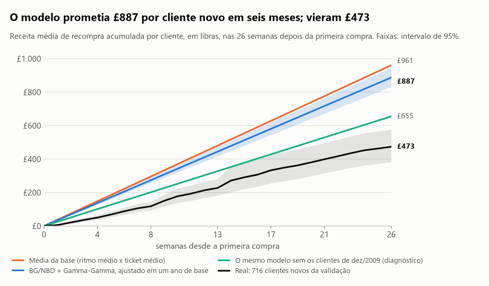
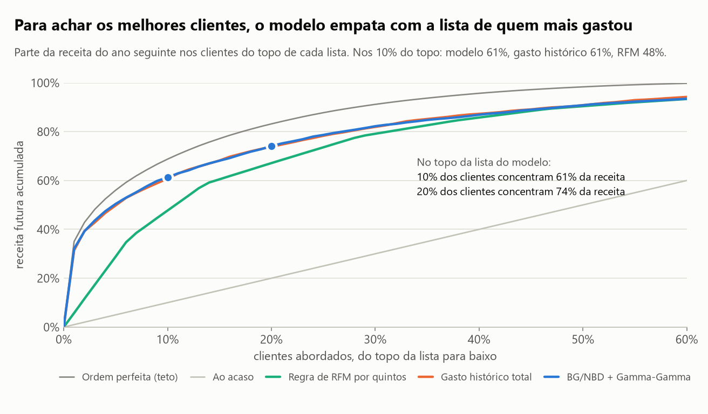
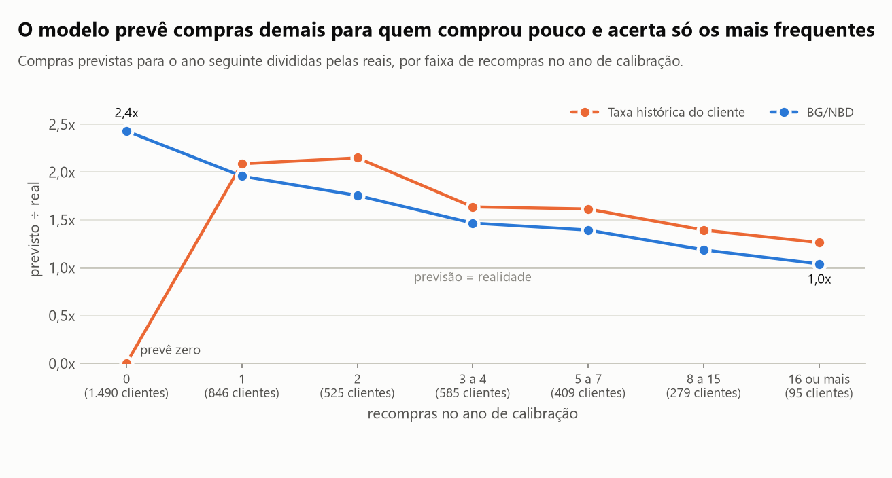
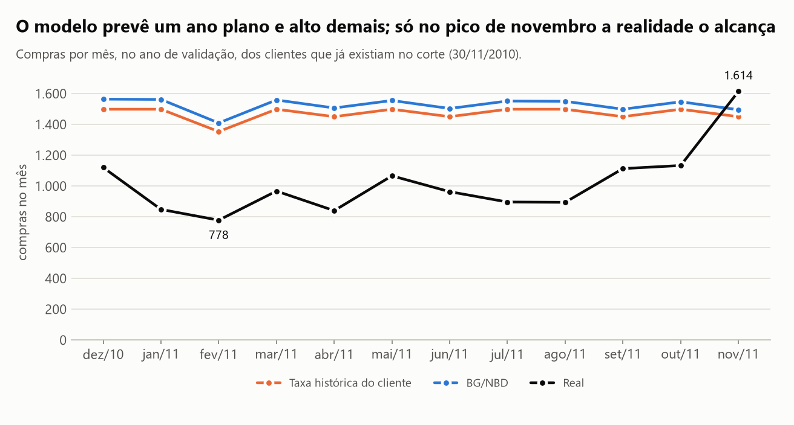
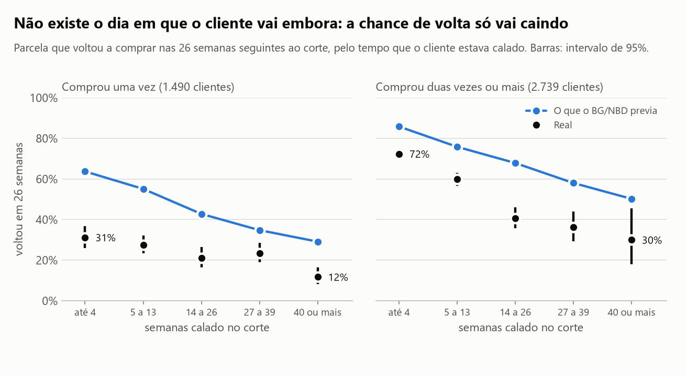
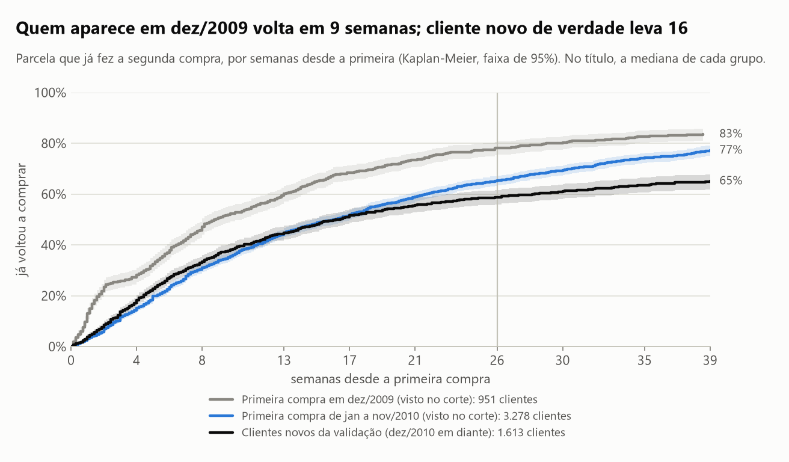

# Quanto vale um cliente novo nos próximos meses, e quando dá para considerar que ele foi embora?

**Menos do que o modelo diz.** Ajustado em um ano de histórico de um varejista online, o modelo clássico de valor
do cliente (BG/NBD + Gamma-Gamma) calculou **£887** de receita de recompra por cliente novo em seis meses (intervalo
de 95%: £832 a £945); os clientes novos do ano seguinte entregaram **£473** (£383 a £576), e a conta simples pela
média da base errou igual (£961). Para ordenar quem já é cliente, o modelo empata com a lista de quem mais gastou
(61% da receita futura nos 10% do topo, nos dois casos), e "foi embora" não tem data: a chance de volta cai aos
poucos com o silêncio.

É o número que define o teto do custo de aquisição e o momento de gastar com reativação. Este estudo mostra quanto
dá para confiar nele quando só se tem um ano de vendas.

## Em 30 segundos

- **Base e desenho.** Online Retail II (UCI): 5.852 clientes e 32.878 dias de compra de um varejista online
  britânico, de dezembro de 2009 a dezembro de 2011. Um ano para ajustar (até 30/11/2010, 4.229 clientes), o ano
  seguinte para conferir. Nada do segundo ano entra no ajuste, nem pela limpeza dos cancelamentos.
- **Valor do cliente novo: o modelo promete 1,9 vez o que veio.** £887 previstos contra £473 reais em seis meses.
  A faixa de incerteza do modelo é estreita e a realidade fica fora dela: o intervalo mede o erro de amostragem dos
  parâmetros, não o erro de ajustar numa população e aplicar em outra.
- **A causa está nos dados.** A base não diz quem é novo de verdade (quem aparece no primeiro mês é, em boa parte,
  cliente antigo), e um ano que termina no pico de novembro esconde o abandono: o modelo estimou que 99,6% dos
  clientes continuavam ativos.
- **Para ordenar clientes, empate com a regra mais simples.** Os 10% do topo da lista do modelo concentram 61,2% da
  receita do ano seguinte; os 10% que mais gastaram até hoje, 60,8% (diferença de −0,5 ponto, intervalo de −1,7 a
  +0,4). A regra de RFM por quintos fica em 47,7%. O teto, com ordem perfeita, é 68,8%.
- **Volume de compras: modelo e regra simples erram para cima.** O BG/NBD previu 50% mais compras do que houve (44%
  a 56%); repetir a taxa histórica de cada cliente, 44% a mais. Conforme a data do corte, o excesso do modelo vai de
  0% a 50%.
- **"Foi embora" é um degradê.** Entre quem comprou duas vezes ou mais, 72% dos que tinham comprado no último mês
  voltaram em seis meses, contra 41% dos calados havia três a seis meses. Entre quem comprou uma vez só, a chance já
  começa em 31% e, depois de nove meses de silêncio, 23% ainda voltaram dentro de um ano.

## O que os dados mostram

### 1. O valor do cliente novo: previsto no corte e realizado



A linha azul é o que o modelo, ajustado com tudo o que se sabia em 30/11/2010, prevê para quem acabou de fazer a
primeira compra: recompras esperadas vezes o ticket médio da base. A linha escura é o que fizeram os 716 clientes cuja
primeira compra na base aconteceu depois do corte (quando já havia um ano de histórico sem eles) e que puderam ser
acompanhados por 26 semanas. A laranja é a conta de padaria: ritmo médio de recompra da base vezes ticket médio.

| Receita de recompra por cliente novo | 13 semanas | 26 semanas | 39 semanas |
|---|---|---|---|
| **Real** (clientes novos da validação) | £291 (219 a 409) | **£473** (383 a 576) | £711 (493 a 980) |
| Clientes acompanhados | 1.022 | 716 | 344 |
| BG/NBD + Gamma-Gamma | £444 (417 a 474) | **£887** (832 a 945) | £1.329 (1.246 a 1.414) |
| Média da base (ritmo médio x ticket médio) | £480 | £961 | £1.441 |
| Coortes antigas (o que os clientes de 2010 fizeram nas primeiras semanas) | £494 | £1.129 | £2.173 |
| *Diagnóstico:* modelo sem os clientes de dez/2009 | £328 | £655 | £983 |
| *Diagnóstico:* coortes antigas sem dez/2009 | £272 | £628 | £1.142 |

Em recompras, o modelo previa 2,19 em seis meses (2,08 a 2,30) e vieram 1,33 (1,17 a 1,50). Os valores não incluem a
primeira compra, que foi de £364 em média.

**Por que o erro.** A base começa em dezembro de 2009 e não tem data de cadastro: "primeira compra na base" não é
"primeira compra da vida". No primeiro mês aparecem 951 clientes "novos"; nos onze meses seguintes, 298 por mês; no
ano de validação, 132 por mês. Boa parte dos "novos" de 2010 são clientes antigos reaparecendo, que compram muito
mais. As duas linhas de diagnóstico refazem as contas sem o primeiro mês: a previsão do modelo cai de £887 para £655,
ainda 38% acima do real. Essa variante foi tentada depois de ver o erro; ela explica a causa, não é validação limpa.

O valor de um cliente também é muito mais desigual do que a média sugere: 49% dos clientes novos não voltaram em
seis meses e a mediana da receita de recompra foi £49. Simulando pelo modelo ajustado, seriam 33% sem recompra e
mediana de £365.

### 2. Quem são os clientes que valem mais



Cada método gera uma lista ordenada dos 4.229 clientes; a curva mostra quanto da receita do ano seguinte está no topo
de cada lista. A do modelo e a de "quem mais gastou até hoje" ficam uma sobre a outra.

| Lista ordenada por | Receita futura nos 10% do topo | Diferença para o modelo | Nos 20% do topo |
|---|---|---|---|
| BG/NBD + Gamma-Gamma | 61,2% (55,0 a 66,4) | | 74,1% (69,8 a 77,7) |
| Gasto histórico total | 60,8% (54,4 a 65,9) | −0,5 pt (−1,7 a +0,4) | 73,8% (69,5 a 77,5) |
| Taxa histórica x ticket do cliente | 60,0% (53,6 a 65,3) | −1,3 pt (−2,2 a −0,6) | 73,8% (69,3 a 77,4) |
| RFM por quintos (M = ticket médio) | 52,9% (45,7 a 59,2) | −8,3 pt (−15,0 a −4,2) | 69,1% (64,6 a 73,3) |
| RFM por quintos (M = gasto total) | 47,7% (41,6 a 53,5) | −13,5 pt (−20,4 a −7,9) | 67,1% (60,8 a 72,4) |
| Ao acaso | 10,0% | | 20,0% |
| Ordem perfeita (teto) | 68,8% (63,8 a 72,9) | +7,5 pt | 83,2% (80,4 a 85,5) |

Os intervalos são de bootstrap sobre clientes; a diferença é calculada na mesma reamostra (pareado), por isso é bem
mais estreita do que o intervalo de cada método. O modelo empata com o gasto histórico e ganha por 1,3 ponto da taxa
histórica. A regra de RFM perde de 8 a 13 pontos: ao transformar cada dimensão em nota de 1 a 5 e somar, ela achata
a diferença entre o cliente grande e o enorme, e nesta base 10% dos clientes fazem 69% da receita.

### 3. Quantas compras: o modelo prevê demais



| Recompras na calibração | Clientes | Compras reais no ano seguinte | BG/NBD | Taxa histórica |
|---|---|---|---|---|
| 0 | 1.490 | 0,84 | 2,04 | 0,00 |
| 1 | 846 | 1,52 | 2,98 | 3,18 |
| 2 | 525 | 2,15 | 3,76 | 4,61 |
| 3 a 4 | 585 | 3,25 | 4,76 | 5,31 |
| 5 a 7 | 409 | 4,82 | 6,72 | 7,78 |
| 8 a 15 | 279 | 8,62 | 10,23 | 12,01 |
| 16 ou mais | 95 | 24,12 | 25,06 | 30,45 |

O modelo prevê 2,4 vezes as compras reais de quem nunca tinha recomprado e só acerta os 95 clientes mais frequentes.
O motivo aparece nos parâmetros: o abandono médio estimado por recompra é 0,15%, e a probabilidade de estar "vivo"
fica em 99,6% na média. O modelo olhou um ano de compras e concluiu que ninguém vai embora; na prática virou um
modelo sem abandono.



Mês a mês, o modelo prevê um ano plano, perto de 1.500 compras por mês. A realidade teve 778 em fevereiro e 1.614 em
novembro, e ficou abaixo do previsto em onze dos doze meses. O modelo não tem sazonalidade, e errou a época de Natal
nos dois sentidos: o nível alto de novembro de 2010 inflou o ritmo que ele projetou para o ano inteiro, e o pico de
novembro de 2011 foi o único mês em que a realidade o alcançou.

### 4. Quando considerar que o cliente foi embora



Aqui não há contrato nem cancelamento: o abandono nunca é observado, só o silêncio. A conferência direta é olhar
quanto tempo cada cliente estava calado no corte e quantos voltaram depois.

| Semanas calado no corte | Comprou uma vez: voltou em 26 semanas | em 52 semanas | Comprou duas vezes ou mais: voltou em 26 semanas | em 52 semanas |
|---|---|---|---|---|
| até 4 | 31% (26 a 37) | 50% | 72% (70 a 75) | 87% |
| 5 a 13 | 28% (23 a 32) | 49% | 60% (57 a 63) | 76% |
| 14 a 26 | 21% (17 a 27) | 35% | 41% (36 a 46) | 60% |
| 27 a 39 | 23% (19 a 29) | 34% | 36% (29 a 44) | 50% |
| 40 ou mais | 12% (8 a 16) | 23% | 30% (18 a 45) | 33% |

Não aparece um ponto de corte. O que separa os clientes é, antes de tudo, já terem voltado alguma vez: quem comprou
uma vez só tem 31% de chance de voltar em seis meses mesmo tendo comprado no último mês. Para quem é recorrente, a
chance cai abaixo de 50% depois de três meses de silêncio. O BG/NBD (linha azul), que não enxergou abandono, prometia
volta demais em todas as faixas; e a "probabilidade de estar vivo" que ele calcula não serve de régua aqui, porque
vale 1 por construção para quem nunca recomprou.



A curva de Kaplan-Meier do tempo até a segunda compra trata quem ainda não voltou como censurado, não como perdido.
Ela confirma o diagnóstico da seção 1: quem aparece em dezembro de 2009 volta em 9 semanas (mediana) e 78% já
voltaram em seis meses, ritmo de cliente antigo. Entre os 1.613 clientes novos da validação, a mediana é de 16
semanas e 59% voltam em seis meses (56% a 62%). Pela mesma curva, um cliente novo calado há 13 semanas tem 37% de
chance de voltar nas 26 seguintes (32% a 41%).

## Como foi feito

1. **Dados.** `scripts/baixar_dados.py` baixa o zip da UCI (confere o SHA-256), converte o .xlsx para parquet e gera
   o extrato versionado: uma linha por cliente e dia com compra. Limpeza, com a contagem de cada passo em
   `data/limpeza.json`: das 1.067.371 linhas, saem 22.523 repetidas entre as duas abas (1 a 9 de dezembro de 2010),
   235.287 sem código de cliente, 18.446 de cancelamento (faturas "C"), 70 com quantidade ou preço não positivo e 2.858 de itens
   que não são produto (frete, taxas, ajustes manuais). Ficam 788.187 linhas de compra, £17,1 milhões.
2. **Cancelamentos sem vazamento.** Tirar só as faturas "C" deixaria na base a compra desfeita. Cada cancelamento é
   casado com a compra original (mesmo cliente, item, quantidade e preço): 6.098 linhas, £590 mil, 83% do valor
   cancelado de produtos. A compra casada só é descontada a partir da data do cancelamento, para que um
   cancelamento de 2011 não mude o que o modelo vê em 2010.
3. **Separação no tempo.** Calibração de 1/12/2009 a 30/11/2010; validação de 1/12/2010 a 30/11/2011. Uma "compra" é
   um dia com compra; o tempo é contado em semanas.
4. **BG/NBD** (Fader, Hardie e Lee, 2005), implementado em NumPy/SciPy: log-verossimilhança, ajuste por máxima
   verossimilhança, esperança condicional de compras, probabilidade de estar vivo e de comprar em *t* semanas.
5. **Gamma-Gamma** (Fader e Hardie, 2013) para o valor médio por compra, também implementado. A hipótese de
   independência entre frequência e valor não vale exatamente: correlação de postos de 0,22 (0,19 a 0,25); o ticket
   mediano vai de £249 em quem comprou uma vez a £426 em quem comprou onze vezes ou mais.
6. **Kaplan-Meier** implementado, com erro padrão de Greenwood e intervalo na escala log(−log).
7. **Linhas de base:** taxa histórica de cada cliente, regra de RFM por quintos, média da base, e a lista de gasto
   histórico total.
8. **Validação:** erro por cliente, viés do total, calibração por faixa de frequência, receita capturada nos 10% e
   20% do topo. Intervalos por bootstrap de clientes (2.000 reamostras; diferenças pareadas). A incerteza dos
   parâmetros vem de reajustar os dois modelos em 200 reamostras.
9. **Testes** (`tests/`): cada fórmula fechada bate com uma integral numérica independente; o ajuste recupera os
   parâmetros de dados simulados pelo próprio processo; o exemplo publicado da base CDNOW é reproduzido (1,226 compra
   esperada); o Kaplan-Meier reproduz o exemplo clássico de Freireich; e um teste opcional compara com a biblioteca
   `lifetimes`.

Fonte dos dados: Chen, D. (2019). *Online Retail II*. UCI Machine Learning Repository.
<https://doi.org/10.24432/C5CG6D>. Licença CC BY 4.0. O arquivo bruto não é versionado; o extrato em `data/` é
agregado por cliente e dia e só traz o código numérico do cliente, já anônimo na origem.

## Comparação com a alternativa simples

| Medida, no ano de validação | BG/NBD + Gamma-Gamma | Alternativa simples | Leitura |
|---|---|---|---|
| Receita futura nos 10% do topo | 61,2% | Gasto histórico total: 60,8% (−0,5 pt; −1,7 a +0,4) | **Empate** |
| Receita futura nos 20% do topo | 74,1% | Gasto histórico total: 73,8% (−0,3 pt; −1,4 a +0,7) | **Empate** |
| Receita futura nos 10% do topo | 61,2% | RFM por quintos: 47,7% a 52,9% | Modelo ganha de 8 a 13 pontos |
| Erro absoluto médio de compras por cliente | 2,50 (2,42 a 2,58) | Taxa histórica: 2,59 (diferença −0,09; −0,19 a −0,00) | Modelo ganha por pouco |
| Raiz do erro quadrático médio | 3,58 | Taxa histórica: 4,95 (diferença −1,37; −1,94 a −0,87) | Modelo ganha |
| Viés do total de compras | +50% (44 a 56) | Taxa histórica: +44% (38 a 50); média da base: +63% | Todos erram para cima; a taxa histórica erra menos |
| Valor do cliente novo em 26 semanas (real: £473) | £887 | Média da base: £961 | Os dois erram quase o dobro |
| Erro absoluto médio do ticket futuro | £160 | Média do próprio cliente: £168 (diferença −£9; −15 a −3) | Modelo ganha por pouco na média e perde na mediana (£98 contra £82) |

Em resumo: o modelo ganha onde menos importa (erro por cliente, por evitar exageros nos clientes de poucas compras),
empata no que o negócio usa (achar os melhores clientes) e erra junto com a regra simples no número que a pergunta
pede (o valor do cliente novo).

**O resultado depende do corte?** A ordenação não; o volume, muito.

| Calibração até | Semanas de calibração / validação | P(vivo) média | Viés do BG/NBD no total | Viés da taxa histórica | 10% do topo: modelo / gasto histórico / RFM |
|---|---|---|---|---|---|
| 31/08/2010 | 39 / 52 | 99,7% | +18% (13 a 23) | +11% | 56% / 55% / 51% |
| **30/11/2010 (principal)** | 52 / 52 | 99,6% | +50% (44 a 55) | +44% | 61% / 61% / 48% |
| 31/12/2010 | 56 / 48 | 99,1% | +41% (36 a 47) | +37% | 62% / 61% / 51% |
| 28/02/2011 | 65 / 39 | 95,7% | +18% (14 a 22) | +19% | 62% / 61% / 53% |
| 31/05/2011 | 78 / 26 | 91,5% | +0,5% (−2 a 4) | +7% | 63% / 62% / 57% |

O excesso é maior quando a calibração termina no pico de fim de ano, com todo mundo comprando, e some quando o modelo
já viu o silêncio de janeiro e fevereiro do segundo ano: só aí a probabilidade média de estar vivo sai de 99%. O
corte principal foi fixado antes de olhar os resultados (um ano inteiro de cada lado) e acabou sendo o pior para
o modelo. Os cortes alternativos têm validações mais curtas, todas terminando em novembro de 2011.

## Onde este estudo falha

- **Não se sabe quem é cliente novo.** A base não tem data de cadastro, e esse é o problema central do estudo. Os
  "clientes novos da validação" usados como realidade são os que não compraram nos doze meses anteriores; alguns
  ainda podem ser antigos de compra rara. O diagnóstico sem dezembro de 2009 foi feito depois de ver o erro.
- **Um varejista, muito atacado, dois anos.** 10% dos clientes fazem 69% da receita, então as medidas de receita
  dependem de poucos clientes enormes: o intervalo da captura nos 10% do topo vai de 55% a 66%. Nada aqui garante o
  mesmo empate em outro negócio.
- **Uma validação principal.** O viés de volume vai de 0% a +50% conforme o corte, e os cortes alternativos não são
  independentes entre si (reaproveitam os mesmos meses). Só há um pico de fim de ano em cada lado.
- **Sem sazonalidade e sem alternativa de modelo.** O BG/NBD supõe ritmo constante. Não incluí Pareto/NBD (em que o
  abandono pode acontecer a qualquer momento, não só depois de uma compra) nem variáveis de calendário; é possível
  que identifiquem melhor o abandono com um ano de dados.
- **Receita, não margem, e sem desconto no tempo.** O teto do custo de aquisição é o valor vezes a margem, que a base
  não traz. Devoluções parciais não casam com a compra original e ficam como receita (£123 mil, 0,7% do total).
- **Independência entre frequência e valor não vale** (correlação de 0,22). Multiplicar compras esperadas por ticket
  esperado subestima um pouco os clientes grandes.
- **Os intervalos das métricas de validação tratam as previsões como fixas.** Eles medem a incerteza de avaliar em
  4.229 clientes, não a de reajustar o modelo. E o intervalo do valor do cliente novo só cobre a amostragem dos
  parâmetros: a realidade ficou fora dele.
- **Kaplan-Meier com censura que não é neutra.** Os clientes novos censurados mais cedo são os que entraram perto do
  pico de 2011. A curva dá 59% de retorno em seis meses; entre os 716 que puderam ser acompanhados por seis meses
  inteiros, 51% voltaram.
- **"Probabilidade de estar vivo" do BG/NBD vale 1 para quem nunca recomprou**, por construção do modelo. Para esse
  grupo (35% da base), uso a probabilidade de comprar em *t* semanas, que também saiu alta demais.

## Como rodar

Pré-requisito: [`uv`](https://docs.astral.sh/uv/getting-started/installation/).

```bash
uv sync
uv run python scripts/baixar_dados.py    # baixa 45 MB da UCI, converte e regera o extrato em data/ (uns 5 minutos)
uv run python scripts/rodar_analise.py   # regera reports/resultados.json e as figuras (1 a 3 minutos)
uv run pytest                            # 53 testes (mais 2 de conferência opcional, pulados sem a lifetimes)
```

O extrato já está versionado em `data/`: quem não quiser baixar o bruto pode pular o segundo comando. O notebook
[`analise.ipynb`](analise.ipynb) conta a história com as tabelas; para refazê-lo, `uv run python
scripts/montar_notebook.py` e depois `uv run jupyter nbconvert --to notebook --execute --inplace analise.ipynb`.
A conferência opcional contra a biblioteca `lifetimes` roda com
`uv run --with lifetimes pytest tests/test_conferencia_lifetimes.py`.

```text
src/valor_cliente/   dados.py · bgnbd.py · gamma_gamma.py · sobrevivencia.py · linhas_de_base.py
                     avaliacao.py · analise.py · graficos.py · estilo.py
scripts/             baixar_dados.py · rodar_analise.py · montar_notebook.py
tests/               conferência das fórmulas contra casos de resposta conhecida
reports/             resultados.json e figuras/
data/                compras_por_dia.csv · cancelamentos_casados.csv · limpeza.json (brutos/ fica fora do git)
```

## Como este estudo foi feito

Este estudo foi construído com assistência de IA (Claude Code, da Anthropic), usada como par de programação.
Declaro a divisão do trabalho porque ela importa para quem avalia:

- **Meu:** a direção (quais frentes da ciência de dados estudar e por quê), o contexto de negócio que dá sentido à
  pergunta, vindo de onze anos de marketing digital (tráfego pago desde 2021, automação desde 2018), a leitura crítica dos resultados e a decisão do que
  publicar e do que declarar como limitação.
- **Com o assistente:** a formulação da pergunta a partir desse contexto, a escolha da base pública e do método, a
  implementação do código, dos testes e dos gráficos, e a redação, que revisei.
- **Como conferir:** todo número deste README sai de `reports/resultados.json`, gerado por
  `scripts/rodar_analise.py`. Os testes em `tests/` conferem as funções de método contra casos de resposta
  conhecida.

É o mesmo jeito que trabalho nos sistemas que entrego: a IA acelera a implementação, e a responsabilidade pelo que
está escrito aqui é minha.

## Summary (English)

How much is a new customer worth over the next few months, and when is it fair to call them gone? Using the public
Online Retail II dataset (UCI; 5,852 customers of a UK online retailer, Dec 2009 to Dec 2011), I implemented BG/NBD,
Gamma-Gamma and Kaplan-Meier from scratch in NumPy/SciPy (tested against numerical integrals, simulated data and
published examples), fitted them on the first year and validated on the second. The model predicted £887 of repeat
revenue per new customer over six months (95% CI £832 to £945); customers who actually arrived the following year
delivered £473 (£383 to £576), and a naive customer-base average was just as wrong (£961). The cause is in the data,
not the maths: the dataset cannot tell truly new customers from old ones, and a calibration year ending at the
November peak hides churn (the model estimated 99.6% of customers still active and over-forecast purchases by 50%;
the bias ranges from 0% to 50% depending on the cutoff date). For ranking existing customers the model merely ties
with a plain "top spenders" list (61.2% vs 60.8% of next-year revenue in the top decile; paired difference −0.5
points, CI −1.7 to +0.4) while a quintile RFM rule trails by 8 to 13 points. There is no churn date: the chance of
returning decays gradually with silence, and depends mostly on whether the customer has ever come back before. Code,
notebook and README are in Portuguese.

---

Hélcio Venâncio · [github.com/ghitflux](https://github.com/ghitflux) · Licença MIT
